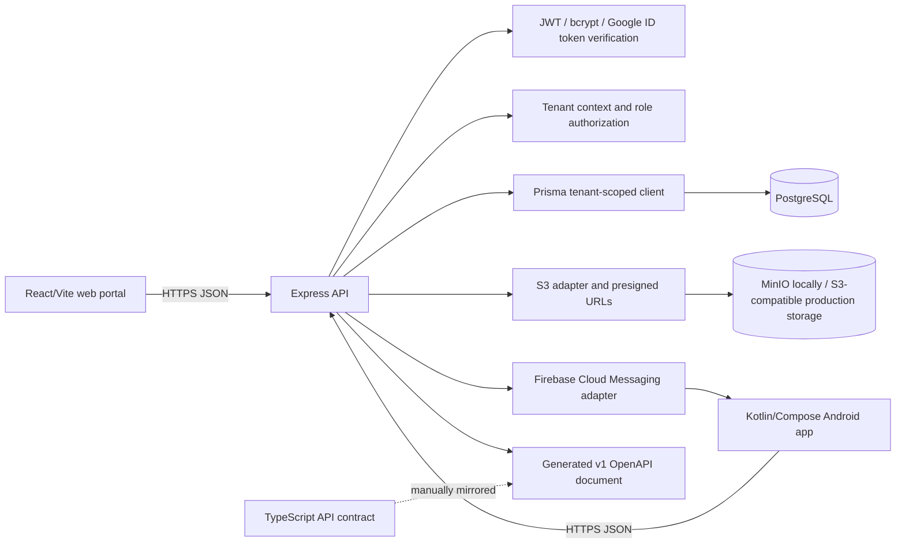
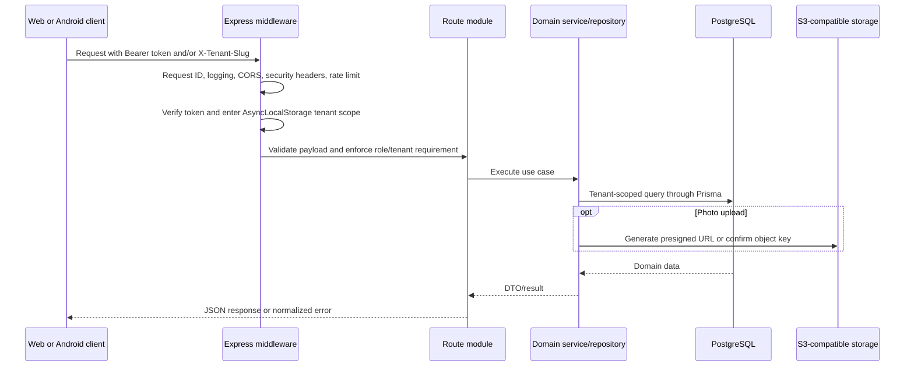
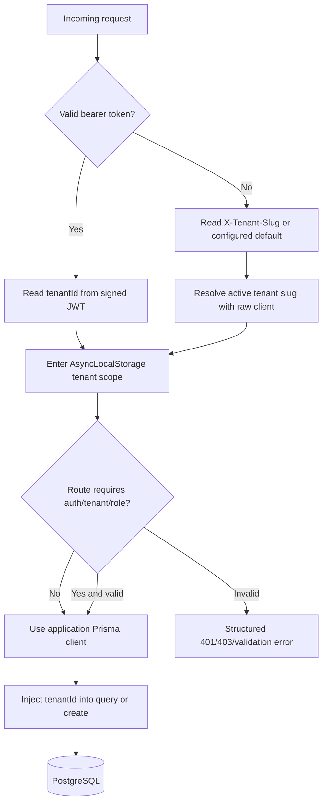
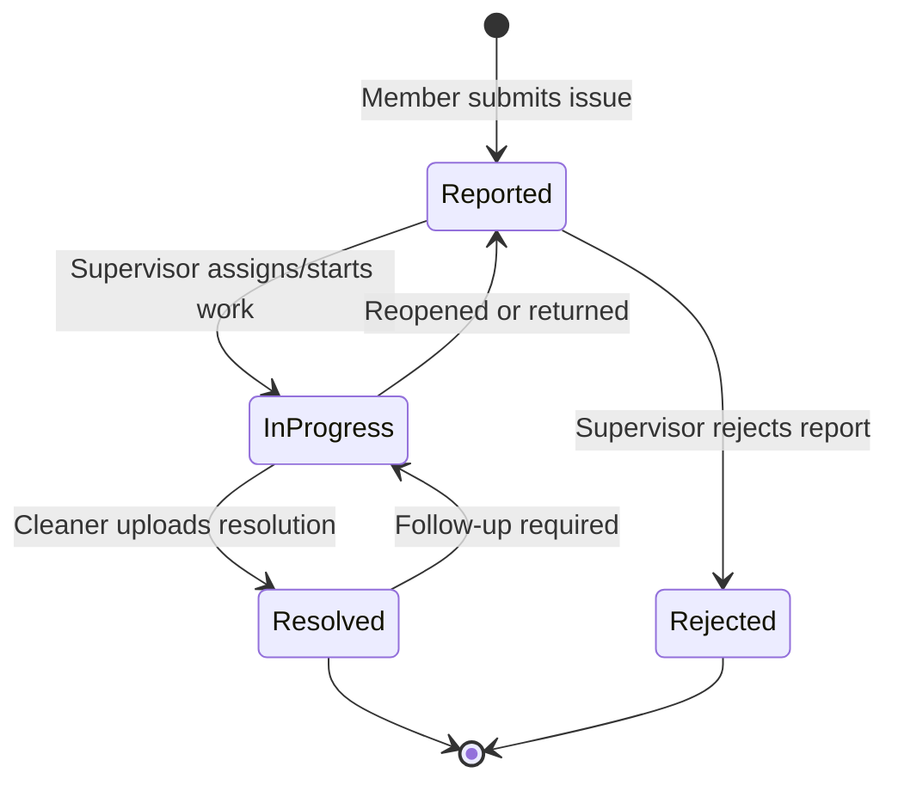
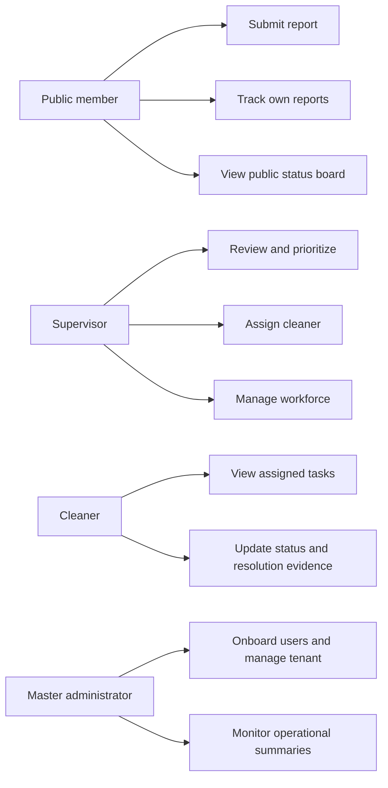

# SpotFix Community: Repository Overview

> **Analysis date:** 2026-10-14  
> **Scope:** repository-wide review from software architect, software developer,
> and product manager perspectives.

## Executive summary

SpotFix Community is an open-source, multi-tenant facilities operations
platform. A member of a community reports a maintenance issue, optionally
attaches location and photo evidence, and follows its progress. Supervisors
triage and assign work, cleaners execute and resolve tasks, and administrators
manage tenants and users. A public status board exposes operational progress
without requiring authentication.

The repository is a polyglot monorepo with:

- a TypeScript/Express API backed by PostgreSQL and Prisma;
- a React/Vite web portal;
- a Kotlin/Jetpack Compose Android client;
- a small manually maintained TypeScript API contract package;
- Docker-based local infrastructure using MinIO as S3-compatible object
  storage;
- example seed data, migrations, ADRs, and GitHub Actions checks.

The core architecture is sound for an early self-hosted/community release:
tenant isolation is treated as a security boundary, domain services are
separated from HTTP routes, object storage is abstracted behind an S3
interface, and API v1 has generated OpenAPI documentation. The main risks are
the coexistence of two API/data models, duplicated client and contract shapes,
uneven automated product-flow coverage, and production-hardening work that is
still left to deployers.

## Contents

- [Technology stack](#technology-stack)
- [Repository map](#repository-map)
- [System architecture](#system-architecture)
- [Backend design](#backend-design)
- [Client design](#client-design)
- [Primary product workflows](#primary-product-workflows)
- [Data and tenancy model](#data-and-tenancy-model)
- [Operational and security posture](#operational-and-security-posture)
- [Developer experience and quality](#developer-experience-and-quality)
- [Architect assessment](#architect-assessment)
- [Developer assessment](#developer-assessment)
- [Product assessment](#product-assessment)
- [Prioritized recommendations](#prioritized-recommendations)
- [Actionable questions](#actionable-questions)
- [Getting started and validation](#getting-started-and-validation)

## Technology stack

| Area | Technologies in use | Role |
| --- | --- | --- |
| Backend runtime | Node.js 24+, TypeScript 6 | API runtime and type-safe implementation |
| HTTP server | Express 5 | Middleware, routing, health, docs, and error handling |
| Validation and API docs | Zod 4, `@asteasolutions/zod-to-openapi`, Swagger UI | Runtime validation and v1 OpenAPI generation |
| Persistence | PostgreSQL 16, Prisma 7, `pg`, `@prisma/adapter-pg` | Relational system of record and migrations |
| Authentication | JWT access/refresh tokens, bcryptjs, Google Auth Library | Password, master, and Google Sign-In authentication |
| Authorization | Role middleware plus tenant-aware Prisma extension | Public, supervisor, cleaner, and master access control |
| Object storage | AWS SDK for S3, MinIO locally | Evidence and resolution photo storage with presigned URLs |
| Notifications | Firebase Cloud Messaging, persisted notification history | Android push delivery and in-app history |
| Logging and protection | Pino, pino-http, Helmet, CORS, express-rate-limit | Request observability and HTTP hardening |
| Web UI | React 19, Vite 8, React Router 7 | Browser portal and role-based workflows |
| Web state/forms | TanStack Query, React Hook Form, Zod | Server state, form handling, and client validation |
| Web UI styling | Tailwind CSS 4, Radix UI, Motion, Phosphor/Lucide icons | Design system, components, and interaction polish |
| Maps and geolocation | Leaflet, React Leaflet, MapLibre GL, React Map GL | Location selection, maps, and v2 geo features |
| Android UI | Kotlin, Jetpack Compose, Material 3, Navigation Compose | Native mobile workflows |
| Android networking | OkHttp, Kotlin serialization, coroutines | API client and asynchronous application flows |
| Android integrations | Credential Manager/Google ID, Firebase Messaging, Play Services Location, osmdroid | Sign-in, push, location, and map support |
| Testing | Vitest, Supertest, JUnit, Compose/UI smoke tests | API unit/integration-style tests and Android tests |
| Build and delivery | npm lockfiles, Gradle, Docker Compose, GitHub Actions | Reproducible local development and CI |
| Licensing | Apache License 2.0 | Community edition licensing |

## Repository map

```text
.
├── apps/
│   ├── api/                    Express + TypeScript + Prisma backend
│   ├── web/                    React + Vite browser portal
│   └── android/                Kotlin + Jetpack Compose Android app
├── packages/
│   └── api-contract/           Hand-maintained TypeScript DTO contract
├── infra/docker/               PostgreSQL, MinIO, API, and web Compose stack
├── examples/seed/              Fictional bootstrap CSV data
├── docs/
│   ├── architecture.md         High-level architecture notes
│   └── adr/                    Architecture decision records
├── scripts/                    Public-tree checks and data/bootstrap utilities
├── .github/workflows/ci.yml    CI for hygiene, API, web, contract, and Android
├── README.md                   Setup, scope, and community-edition boundary
└── ROADMAP.md                  Cleanup, quality, and community-readiness plan
```

The root package is an orchestration manifest rather than a conventional
workspace package. Each application/package owns its own `package.json`,
lockfile, build, and validation commands.

## System architecture



### Request lifecycle

The API application in `apps/api/src/app.ts` applies request IDs and Pino
logging, Helmet, CORS, JSON parsing, and rate limiting before mounting:

- `/api/v1` — canonical, supported v1 API;
- `/api/v2` — experimental API with its own envelopes and modules;
- `/api` — deprecated compatibility alias for v1;
- `/health`, `/api/v1/health`, and OpenAPI/Swagger endpoints.

The v1 router attaches authentication opportunistically, resolves tenant
context, and delegates to route modules. Individual routes then require
authentication, a role, or a tenant as appropriate. Errors are normalized by
central middleware.



## Backend design

### Module boundaries

The API follows a pragmatic layered structure:

- `http/` contains Express middleware, request types, schemas, and route
  composition.
- `domain/` contains use-case services and repositories for auth, users,
  reports, cleaners, devices, photos, notifications, and master users.
- `infra/` contains Prisma, tenant context, storage, and database wiring.
- `openapi/` derives the v1 API description from Zod/OpenAPI schemas.
- `v2/` is a separately organized experimental surface with its own auth,
  serializers, envelopes, services, and routes.

This separation makes the core workflows testable without putting database
details directly in every route. It also creates a clear future seam for
adapters such as identity providers, maps, messaging, and storage.

### API surfaces

**v1 stable surface**

- Auth and identity: user registration, password login, Google login, token
  refresh, logout, current-user profile, and master login.
- Reports: public status board, user reports, report creation/update, photos,
  assignments, and endorsements.
- Workforce: cleaners, supervisors, onboarding, and assignment operations.
- Devices and notifications: device registration, push notification history,
  and notification state.

**v2 experimental surface**

- Separate auth/session and role model.
- Reports, attachments, report events, sync, notifications, and devices.
- Admin, supervisor, and cleaner workflows.
- Tenant geo configuration, landmark data, and monitoring endpoints.
- Presigned upload support and a more explicit response/error envelope.

The v2 surface is not merely a route version: it currently coexists with
additional Prisma models and a second set of service conventions. That makes
the version boundary important for compatibility, migration, and operational
support.

### Authentication and authorization

The v1 system supports two authentication subjects:

- regular users with roles such as `public`, `supervisor`, and `cleaner`;
- tenant-scoped `master` users for administration.

Password hashes use bcrypt. Signed access and refresh tokens carry tenant and
subject metadata. Google ID tokens are verified server-side before account
linking or creation. Session-version counters allow logout/revocation without
maintaining a server-side token blacklist.

Authorization is implemented in two layers:

1. route middleware checks authentication and roles;
2. the Prisma application client injects `tenantId` into reads, writes, and
   creates for all listed tenant-scoped models.

### Tenancy and persistence

The schema uses a shared PostgreSQL database with a discriminator column:
nearly every domain model carries `tenantId`. `AsyncLocalStorage` carries the
current tenant through the request. Tenant identity comes from a verified JWT
or an `X-Tenant-Slug` header for tenant-aware public endpoints.



This is an efficient single-database tenancy model and a strong default for
community deployments. Its correctness depends on keeping the tenant model
registry complete and restricting `prismaRaw` to bootstrap, migration, and
tenant-resolution code.

### Photo and media flow

The preferred flow is to request a presigned PUT URL, upload directly from a
client to MinIO/S3, and confirm the object key through the API. Keys are
prefixed with the tenant and report identifiers. The API can still handle
legacy data URLs/URLs for compatibility, which is useful for migration but
should not become the long-term default for large media.

## Client design

### Web portal

The web application currently contains two generations:

- `apps/web/src/design-revamp` is a typed React/Router/TanStack Query
  implementation with role-oriented pages, reusable UI components, lazy
  routes, and a design-token layer.
- `apps/web/src/App.jsx` and adjacent JavaScript modules are a larger legacy
  implementation that still contains overlapping API and monitoring behavior.

The revamp exposes flows for:

- public login, registration, Google Sign-In, and status board viewing;
- report submission with location/photo support and personal report history;
- cleaner tasks and account management;
- supervisor task board, workforce management, and onboarding;
- administrator overview, user management, and onboarding.

Both the revamp API client and legacy client persist bearer/refresh tokens in
browser `localStorage`. This is convenient for a self-contained SPA, but it
increases the impact of any XSS vulnerability. A future web security
iteration should consider an HttpOnly cookie/session design or a carefully
bounded token strategy with explicit threat-model documentation.

### Android app

The Android app uses Kotlin, Compose, ViewModels, coroutines, OkHttp, and
Kotlin serialization. Its structure separates API/DTOs, session storage,
feature screens, design system, notifications, and support utilities.

Implemented mobile capabilities include:

- public status and report composition;
- role-based staff dashboards;
- Google Sign-In through Credential Manager;
- device registration and Firebase push notifications;
- location selection and map support;
- token refresh and session persistence.

The Android client is a direct v1 consumer and contains mapping logic from
wire DTOs to app models. It has useful unit and smoke tests, but does not yet
appear to share generated models with the TypeScript contract package.

## Primary product workflows

### Report lifecycle



The report model carries status, priority, category, location, coordinates,
reporter information, evidence/resolution photos, assignment metadata, review
metadata, and timestamps. This supports a credible operational audit trail,
although the v1 model is still largely state-and-field based rather than an
immutable event stream.

### Role-based operating model



This role model aligns the product with a facilities coordination workflow:
the reporter creates demand, the supervisor manages capacity, the cleaner
closes work, and the administrator manages the operating environment.

## Data and tenancy model

The main v1 entities are `Tenant`, `UserAccount`, `MasterUser`, `Cleaner`,
`Report`, `DeviceRegistration`, and `NotificationEvent`. The v2 migration
adds explicit device sessions, role assignments, report attachments/events,
notifications, and tenant geo/landmark models.

Important invariants visible in the schema and infrastructure include:

- user, master, and report identifiers are unique within a tenant;
- report public IDs use a per-tenant sequence;
- report and notification queries are indexed by tenant plus operational
  fields such as status, user, assignee, or timestamp;
- object storage keys include tenant and report prefixes;
- notification/device records are tenant-scoped;
- v1 and v2 tables share the same physical database but not the same domain
  conventions.

The main architectural decision is **shared database, shared schema,
tenant discriminator**. It is inexpensive to operate and easy to provision,
but it requires disciplined query boundaries, tenant-aware test cases, and
careful handling of administrative/cross-tenant monitoring endpoints.

## Operational and security posture

### Existing strengths

- Helmet, CORS configuration, request IDs, structured logging, and rate
  limiting are in the API pipeline.
- Secrets are expected to be supplied through environment configuration.
- Passwords are hashed and Google tokens are verified rather than trusted
  from client claims.
- Tenant-scoped Prisma access fails closed when no context exists.
- Presigned storage URLs avoid routing large photo bodies through the API.
- `scripts/check-public-tree.sh` rejects common credentials, private
  identifiers, generated output, and key material from the public tree.
- The repository explicitly separates fictional demo data from production
  credentials and private deployment automation.

### Risks and hardening areas

- Browser tokens in `localStorage` are vulnerable to theft after an XSS issue.
- Local Compose defaults use permissive development credentials and wildcard
  CORS; production deployments must not copy these defaults.
- Tenant context is a security boundary. Any future raw Prisma query or new
  tenant-bearing model needs a review and a regression test.
- The public/cross-tenant monitoring surface needs especially explicit
  authorization and data-minimization rules.
- Photo and URL compatibility paths increase the input surface and should be
  constrained with content-type, size, ownership, and lifecycle checks.
- Dependency and supply-chain checks exist in CI, but runtime observability,
  backup/restore verification, secret rotation, and incident runbooks are
  deployment responsibilities rather than repository capabilities.

## Developer experience and quality

### Validation currently provided

The root `npm run check` runs public-tree hygiene, API type checking and
tests, web production build, and API-contract type checking. The Android
workflow runs unit tests and a debug assembly. GitHub Actions also runs
high-severity npm audits.

Tests cover meaningful API auth/report behavior and Android view-model/smoke
flows. The web build is validated, but the repository does not show an
equivalent browser component/e2e suite for the highest-value user journeys.

### Maintainability observations

**Good patterns**

- API route, service, repository, and infrastructure responsibilities are
  recognizable.
- Environment parsing is centralized.
- OpenAPI schemas and API contract types make the wire format visible.
- Android feature folders and ViewModels give the native app a coherent shape.
- ADRs document significant decisions such as tenancy and Google Sign-In.

**Friction points**

- The legacy web tree and design-revamp tree duplicate routes, API clients, and
  state behavior.
- `packages/api-contract` is explicitly hand-synchronized, which can drift
  from Zod/OpenAPI schemas.
- v1 and v2 duplicate domain concepts and persistence models while both remain
  active.
- Large client files and broad feature modules increase the cost of safely
  changing a workflow.
- The Android client maintains its own DTO/model mapping instead of consuming a
  generated contract.
- There is no obvious single root workspace command for installing all
  package dependencies; contributors must know the per-app commands.

## Architect assessment

### Architecture strengths

1. **Clear system-of-record boundary:** PostgreSQL is the source of truth,
   while object storage is used for binary media.
2. **Security-aware tenancy:** tenant context is centralized and enforced at
   the data-access boundary rather than relying only on route authors.
3. **Adapter-friendly integrations:** S3, Google identity, Firebase, and geo
   behavior have identifiable seams for replacement or managed deployments.
4. **Versioning intent is explicit:** v1 is stable and v2 is isolated rather
   than silently changing the existing contract.
5. **Deployment portability:** Docker Compose and S3-compatible APIs support
   local development and multiple hosting providers.

### Architecture concerns

1. **Two active domain architectures:** v2 is a second model of reports,
   sessions, roles, uploads, and notifications, not only a protocol revision.
   This can double migration and support cost.
2. **Shared-schema scaling ceiling:** a very large tenant or reporting query
   can contend with all other tenants unless indexes, workload isolation, and
   query budgets are managed.
3. **In-process state:** tenant slug caching and process-local request context
   are appropriate for one API process, but horizontal scaling needs shared
   observability and careful cache invalidation assumptions.
4. **Event history is incomplete:** operational state is stored on reports,
   while v2 begins to add events. A consistent audit/event strategy would
   improve traceability and analytics.

## Developer assessment

### Highest-value improvements

- Select one canonical web implementation and retire or quarantine the other.
- Generate the TypeScript contract from the OpenAPI/Zod source, or enforce
  contract drift in CI rather than relying on manual synchronization.
- Add disposable PostgreSQL/MinIO integration tests for tenant isolation,
  uploads, authorization, and report lifecycle transitions.
- Add web component/e2e tests for registration, report submission, assignment,
  resolution, and public status flows.
- Create shared API fixtures and status/role constants to reduce string drift
  across TypeScript and Kotlin.
- Add formatting/linting and module-level ownership incrementally, as already
  suggested by the roadmap.

## Product assessment

### Product value and user fit

The product has a coherent wedge: turn unstructured facility complaints into
assigned, trackable work. The combination of location, evidence, status,
assignment, resolution evidence, and a public board directly supports trust
and accountability. Multi-tenancy makes the platform suitable for campuses,
institutions, or managed facilities rather than only one site.

The role model is understandable, and the public status board can reduce
duplicate reports and reassure reporters that work is visible. Push
notifications and mobile support fit field operations where staff may not sit
at a desk.

### Product risks and opportunities

- The user experience may diverge between the legacy web app, design revamp,
  and Android app unless the product flow and contract are centralized.
- Report status semantics need a published, user-facing definition. For
  example, “Reported”, “In Progress”, “Resolved”, and “Rejected” should have
  clear entry criteria and reopening rules.
- Assignment and escalation rules appear primarily manual. Capacity,
  overdue-task, SLA, and escalation concepts would make the product more
  operationally valuable.
- Public visibility needs a privacy policy for locations, reporter data,
  photos, and sensitive facilities.
- The platform needs measurable success metrics: time to first assignment,
  time to resolution, reopen rate, duplicate rate, notification delivery, and
  active tenants.
- Onboarding, tenant configuration, map/geo setup, and notification setup are
  operationally important but currently require environment/bootstrap work.

## Prioritized recommendations

### P0 — protect correctness and trust

1. Add integration tests that prove cross-tenant reads, writes, report IDs,
   photo keys, notifications, and admin/monitoring endpoints cannot leak data.
2. Define and test the authoritative v1/v2 ownership and migration strategy.
   Do not let both models silently become permanent sources of truth.
3. Replace development Compose credentials and wildcard CORS in any production
   deployment template, and document required production controls.

### P1 — reduce change cost

4. Make OpenAPI the single contract source and generate TypeScript types;
   introduce an automated drift check for clients.
5. Finish the web migration to one route tree/API client, then remove the
   duplicate implementation or clearly isolate it as legacy.
6. Add browser tests for the critical reporter, supervisor, cleaner, and
   public-board journeys.

### P2 — increase operational value

7. Add SLA/aging, assignment history, escalation, and audit-log reporting.
8. Define tenant-level configuration for branding, categories, geo boundaries,
   notification policy, and public-board privacy.
9. Establish production runbooks for backups, restore drills, secret rotation,
   object lifecycle cleanup, alerting, and incident response.

## Actionable questions

1. Is v2 intended to replace v1, or will the project support both long term?
2. Which client is the product standard: the design-revamp web portal or the
   legacy `App.jsx` implementation?
3. Should the TypeScript contract be generated from OpenAPI, and should an
   equivalent generated Kotlin client/model be introduced?
4. What data is permitted on the public status board, especially coordinates,
   photos, sensitive locations, and reporter-identifying fields?
5. What are the exact SLA and escalation rules for unassigned or overdue
   reports?
6. Which events must be immutable for audit/compliance purposes?
7. What is the expected tenant scale, and when would shared-schema PostgreSQL
   need partitioning, workload isolation, or separate databases?
8. Are browser tokens in `localStorage` an accepted threat-model decision, or
   should the web app move to an HttpOnly-cookie session?
9. Which external integrations are required for a first production tenant:
   Google identity, Firebase, maps/geocoding, email, or all of them?
10. What product metrics determine whether a tenant is successfully improving
    maintenance response time?

## Getting started and validation

The canonical setup and safety notes are in [README.md](./README.md). The
intended local stack is PostgreSQL, MinIO, the API, and the web server through
Docker Compose. The key validation commands are:

```bash
npm run check
npm run android:test
```

For API work, the important focused commands are:

```bash
npm run api:typecheck
npm run api:test
npm --prefix apps/api run prisma:generate
```

For web and contract work:

```bash
npm run web:build
npm run contract:typecheck
```

This overview is an architectural/product snapshot, not a replacement for
the API OpenAPI document, ADRs, security policy, or deployment runbooks.
